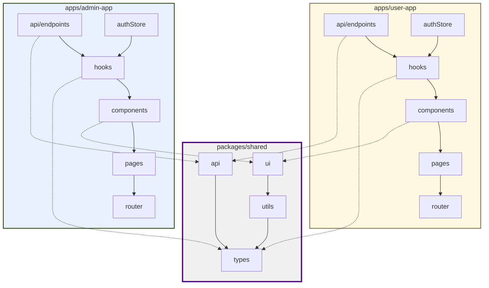

# Dépendances entre composants

## Règle fondamentale
`apps/user-app` et `apps/admin-app` n'ont **aucune dépendance l'une envers l'autre**. Toutes deux dépendent uniquement de `packages/shared`, exclusivement via ses 4 sous-chemins d'export (`/types`, `/api`, `/ui`, `/utils`) — jamais par import profond ni racine du package.

## Matrice de dépendances

| Composant | Dépend de |
|---|---|
| `packages/shared/types` | (aucune dépendance interne) |
| `packages/shared/api` | `@chapelle/shared/types` |
| `packages/shared/ui` | `@chapelle/shared/utils` (pour `cn()`) |
| `packages/shared/utils` | `@chapelle/shared/types` (pour typer les validateurs) |
| `apps/*/api/endpoints/*` | `@chapelle/shared/api`, `@chapelle/shared/types` |
| `apps/*/hooks/*` | `apps/*/api/endpoints/*`, `@chapelle/shared/types`, TanStack Query |
| `apps/*/store/authStore` | `@chapelle/shared/types` |
| `apps/*/components/*` (présentationnels) | `@chapelle/shared/ui`, `@chapelle/shared/utils`, `apps/*/hooks/*` (pour les composants connectés) |
| `apps/*/pages/*` | `apps/*/components/*`, `apps/*/hooks/*` |
| `apps/*/router.tsx` | `apps/*/pages/*` (import dynamique pour les pages lazy), `apps/*/components/auth/ProtectedRoute` |
| `apps/user-app/*` | `packages/shared/*` uniquement — **jamais** `apps/admin-app/*` |
| `apps/admin-app/*` | `packages/shared/*` uniquement — **jamais** `apps/user-app/*` |

## Diagramme



### Alternative textuelle
```
packages/shared : types <- api ; utils <- ui ; types <- utils (validators)
apps/user-app   : api/endpoints -> hooks -> components -> pages -> router ; authStore -> hooks
apps/admin-app  : api/endpoints -> hooks -> components -> pages -> router ; authStore -> hooks
apps/user-app  -.-> packages/shared (api, ui, types)
apps/admin-app -.-> packages/shared (api, ui, types)
Aucune flèche entre apps/user-app et apps/admin-app.
```

## Ordre de construction impliqué
`packages/shared` doit être livré (types + api + ui + utils) **avant** que les modules applicatifs de `user-app`/`admin-app` qui en dépendent ne puissent être développés — ceci structure directement la Génération des unités (étape suivante) : l'unité "Fondation" (monorepo + shared) précède toutes les autres.
