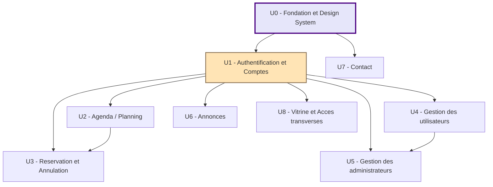

# Dépendances entre unités de travail

## Matrice de dépendances

| Unité | Dépend de | Bloque |
|---|---|---|
| U0 — Fondation & Design System | — | U1, U2, U3, U4, U5, U6, U7, U8 |
| U1 — Authentification & Comptes | U0 | U2, U3, U4, U5, U6, U8 |
| U2 — Agenda / Planning | U0, U1 | U3 |
| U3 — Réservation & Annulation | U0, U1, U2 | — |
| U4 — Gestion des utilisateurs | U0, U1 | U5 |
| U5 — Gestion des administrateurs | U0, U1, U4 | — |
| U6 — Annonces ⚠️ | U0, U1 | — |
| U7 — Contact ⚠️ | U0 | — |
| U8 — Vitrine & Accès transverses | U0, U1 | — |

## Diagramme



### Alternative textuelle
```
U0 (Fondation) -> U1 (Authentification) -> U2 (Agenda/Planning) -> U3 (Réservation/Annulation)
U0 -> U7 (Contact, indépendante après U0)
U1 -> U4 (Gestion utilisateurs) -> U5 (Gestion administrateurs)
U1 -> U6 (Annonces)
U1 -> U8 (Vitrine & accès transverses)
```

## Vagues de parallélisation

- **Vague 0 (séquentielle, bloquante)** : U0, puis U1 — aucune autre unité ne peut démarrer avant que U1 soit terminée (toutes dépendent au moins de U0 ; la plupart dépendent aussi de U1 pour l'état d'authentification)
- **Vague 1 (parallélisable après U0+U1)** :
  - Chaîne A : U2 → U3 (séquentielle en interne, indépendante des autres chaînes)
  - Chaîne B : U4 → U5 (séquentielle en interne, indépendante des autres chaînes)
  - U6 (indépendante)
  - U7 (indépendante, ne dépend même pas de U1)
  - U8 (indépendante)

**Recommandation pour l'étape 4 de `/aidlc-nouveau-projet`** : traiter U0 et U1 séquentiellement dans cette session (fondations partagées, risque de conflit élevé si parallélisées), puis proposer `/launch-team "U2+U3 | U4+U5 | U6 | U7 | U8"` pour la Vague 1 si un traitement parallèle est souhaité — ou les traiter une à une dans cette même session si la préférence va à la simplicité plutôt qu'à la vitesse.
