# Plan d'exécution

## Résumé de l'analyse détaillée

### Évaluation de l'impact du changement
- **Changements destinés aux utilisateurs** : Oui — 42 récits utilisateur, 5 rôles, 2 applications complètes
- **Changements structurels** : Oui — passage du template mono-app actuel à un monorepo npm workspaces (`apps/user-app`, `apps/admin-app`, `packages/shared`)
- **Changements de modèle de données** : Oui — types TypeScript alignés sur le swagger (User, Booking, PlanningEntry, Annonce, MessageContact)
- **Changements d'API** : Oui — intégration complète du contrat swagger fourni (auth, users, bookings, planning) + 3 endpoints mockés MSW (annonces, contact, changement mdp — absent)
- **Impact NFR** : Oui — sécurité (cookie cross-origine, CORS), performance (code-splitting, budget bundle), accessibilité (WCAG AA), i18n

### Évaluation des risques
- **Niveau de risque** : Moyen — projet greenfield (pas de prod existante, rollback trivial), mais surface fonctionnelle large (5 rôles, 2 apps, ~9 domaines) et 2 domaines (Annonces, Contact) dépendants d'un contrat API non finalisé côté backend
- **Complexité du rollback** : Facile (aucun déploiement existant à préserver)
- **Complexité des tests** : Modérée à élevée — 4 niveaux de tests (unitaires, composants, intégration MSW, E2E Playwright) sur 2 applications + package partagé

## Visualisation du workflow

```mermaid
flowchart TD
    Start(["Demande de l'utilisateur"])

    subgraph INCEPTION["PHASE D'INCEPTION"]
        WD["Détection de l'espace de travail<br/><b>TERMINE</b>"]
        RA["Analyse des exigences<br/><b>TERMINE</b>"]
        US["Recits utilisateur<br/><b>TERMINE</b>"]
        WP["Planification du workflow<br/><b>EN COURS</b>"]
        AD["Conception de l'application<br/><b>EXECUTER</b>"]
        UG["Genération des unites<br/><b>EXECUTER</b>"]
    end

    subgraph CONSTRUCTION["PHASE DE CONSTRUCTION (par unite)"]
        FD["Conception fonctionnelle<br/><b>CONDITIONNEL</b>"]
        NFRA["Exigences NFR<br/><b>CONDITIONNEL</b>"]
        ID["Conception infrastructure<br/><b>CONDITIONNEL</b>"]
        CG["Generation de code<br/><b>EXECUTER</b>"]
        BT["Build et Tests<br/><b>EXECUTER</b>"]
    end

    subgraph OPERATIONS["PHASE D'EXPLOITATION"]
        OPS["Exploitation<br/><b>RESERVE</b>"]
    end

    Start --> WD
    WD --> RA
    RA --> US
    US --> WP
    WP --> AD
    AD --> UG
    UG --> FD
    FD --> NFRA
    NFRA --> ID
    ID --> CG
    CG --> BT
    BT --> OPS

    style WD fill:#90EE90,stroke:#2d5016,stroke-width:3px
    style RA fill:#90EE90,stroke:#2d5016,stroke-width:3px
    style US fill:#90EE90,stroke:#2d5016,stroke-width:3px
    style WP fill:#FFE4B5,stroke:#8B7355,stroke-width:2px,stroke-dasharray: 5 5
    style AD fill:#FFE4B5,stroke:#8B7355,stroke-width:2px,stroke-dasharray: 5 5
    style UG fill:#FFE4B5,stroke:#8B7355,stroke-width:2px,stroke-dasharray: 5 5
    style FD fill:#FFE4B5,stroke:#8B7355,stroke-width:2px,stroke-dasharray: 5 5
    style NFRA fill:#FFE4B5,stroke:#8B7355,stroke-width:2px,stroke-dasharray: 5 5
    style ID fill:#FFE4B5,stroke:#8B7355,stroke-width:2px,stroke-dasharray: 5 5
    style CG fill:#90EE90,stroke:#2d5016,stroke-width:3px
    style BT fill:#90EE90,stroke:#2d5016,stroke-width:3px
    style OPS fill:#f0f0f0,stroke:#999999,stroke-width:2px,stroke-dasharray: 5 5
    style Start fill:#E6E6FA,stroke:#4B0082,stroke-width:2px
```



### Alternative textuelle
```
INCEPTION : Détection espace de travail (TERMINÉ) → Analyse exigences (TERMINÉ) → Récits utilisateur (TERMINÉ)
          → Planification du workflow (EN COURS) → Conception de l'application (EXÉCUTER) → Génération des unités (EXÉCUTER)
CONSTRUCTION (boucle par unité) : Conception fonctionnelle (CONDITIONNEL) → Exigences NFR (CONDITIONNEL)
          → Conception infrastructure (CONDITIONNEL) → Génération de code (TOUJOURS) → Build et Tests (TOUJOURS, après toutes les unités)
EXPLOITATION : Réservé
```

## Phases à exécuter

### 🔵 PHASE D'INCEPTION
- [x] Détection de l'espace de travail (TERMINÉ)
- [x] Rétro-ingénierie (IGNORÉ — greenfield-à-partir-d'un-template, aucun comportement métier existant à documenter)
- [x] Analyse des exigences (TERMINÉ)
- [x] Récits utilisateur (TERMINÉ)
- [x] Plan d'exécution (EN COURS)
- [ ] Conception de l'application — **EXÉCUTER**
  - **Justification** : plusieurs nouveaux composants/services doivent être définis à travers 3 packages (store d'auth, client API, composants UI partagés, hooks métier par domaine) ; les dépendances entre `apps/user-app`, `apps/admin-app` et `packages/shared` doivent être clarifiées (règle stricte : pas de dépendance croisée entre les deux apps)
- [ ] Génération des unités — **EXÉCUTER**
  - **Justification** : système complexe (2 apps + package partagé, ~9 domaines métier) nécessitant une décomposition en unités de travail exécutables indépendamment, avec dépendances explicites (ex. `packages/shared` doit précéder les apps)

### 🟢 PHASE DE CONSTRUCTION (évaluée par unité, une fois les unités connues)
- [ ] Conception fonctionnelle — **CONDITIONNEL par unité** (probable pour les unités avec logique métier : réservation, annulation, validation de comptes ; peu probable pour les unités de pages statiques)
- [ ] Exigences/Conception NFR — **CONDITIONNEL par unité** (probable pour l'unité fondation partagée : cookie de session, CORS, code-splitting ; et pour l'unité Réservation/Planning : performance du calendrier)
- [ ] Conception de l'infrastructure — **CONDITIONNEL par unité** (probable pour l'unité fondation : Dockerfile multi-stage + Nginx, docker-compose)
- [ ] Planification du code — **EXÉCUTER (TOUJOURS)**, par unité
- [ ] Génération de code — **EXÉCUTER (TOUJOURS)**, par unité — délégué à `api-architect`/`api-developer`/`test-engineer`/`bruno-developer`/`code-reviewer` selon la chaîne `/build-api`
- [ ] Build et Tests — **EXÉCUTER (TOUJOURS)**, après achèvement de toutes les unités retenues pour ce cycle

### 🟡 PHASE D'EXPLOITATION
- [ ] Exploitation — RÉSERVÉ (hors périmètre de ce cycle)

## Calendrier estimé
- **Total des étapes Inception restantes** : 2 (Conception de l'application, Génération des unités)
- **Durée estimée** : dépend fortement du nombre d'unités retenues pour la Construction et du mode choisi à l'Étape 4 de `/aidlc-nouveau-projet` (séquentiel en session unique vs `/launch-team` en parallèle) — décision à prendre après la Génération des unités

## Critères de succès
- **Objectif principal** : disposer d'un monorepo fonctionnel avec les deux applications déployables indépendamment, alignées sur le swagger fourni et couvrant les 42 récits utilisateur approuvés
- **Livrables clés** : cf. `requirements.md` section "Livrables attendus" (prompt-frontend-revise.md §10)
- **Points de contrôle qualité** : revue de code (`code-reviewer`) et suite de tests (≥80% coverage hooks/utils) par unité avant passage à l'unité suivante
