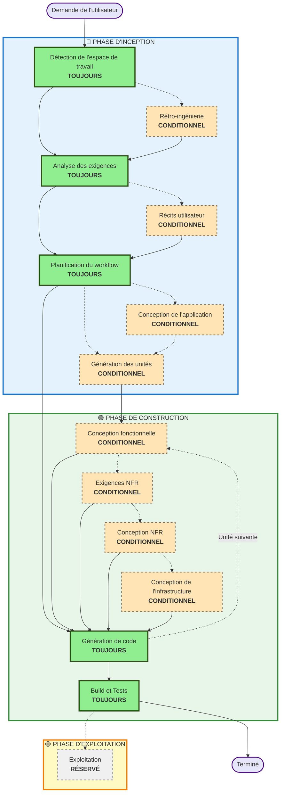

# Vue d'ensemble du workflow adaptatif AI-DLC

**Objectif** : référence technique pour le modèle d'IA et les développeurs afin de comprendre la structure complète du workflow.

**Remarque** : un contenu similaire existe dans core-workflow.md (message d'accueil utilisateur) et README.md (documentation). Cette duplication est INTENTIONNELLE — chaque fichier a un but différent :
- **Ce fichier** : référence technique détaillée avec diagramme Mermaid pour le chargement de contexte par le modèle d'IA
- **core-workflow.md** : message d'accueil destiné à l'utilisateur avec diagramme ASCII
- **README.md** : documentation lisible par un humain pour le dépôt

## Le cycle de vie en trois phases :
• **PHASE D'INCEPTION** : planification et architecture (Détection de l'espace de travail + phases conditionnelles + Planification du workflow)
• **PHASE DE CONSTRUCTION** : conception, implémentation, build et tests (conception par unité + Planification/Génération de code + Build et Tests)
• **PHASE D'EXPLOITATION** : emplacement réservé pour les futurs workflows de déploiement et de supervision

## Le workflow adaptatif :
• **Détection de l'espace de travail** (toujours) → **Rétro-ingénierie** (brownfield uniquement) → **Analyse des exigences** (toujours, profondeur adaptative) → **Phases conditionnelles** (selon les besoins) → **Planification du workflow** (toujours) → **Génération de code** (toujours, par unité) → **Build et Tests** (toujours)

## Comment cela fonctionne :
• **L'IA analyse** votre demande, votre espace de travail et la complexité pour déterminer les étapes nécessaires
• **Ces étapes s'exécutent toujours** : Détection de l'espace de travail, Analyse des exigences (profondeur adaptative), Planification du workflow, Génération de code (par unité), Build et Tests
• **Toutes les autres étapes sont conditionnelles** : Rétro-ingénierie, Récits utilisateur, Conception de l'application, Génération des unités, étapes de conception par unité (Conception fonctionnelle, Exigences NFR, Conception NFR, Conception de l'infrastructure)
• **Aucune séquence fixe** : les étapes s'exécutent dans l'ordre qui a du sens pour votre tâche spécifique

## Le rôle de votre équipe :
• **Répondre aux questions** dans les fichiers de questions dédiés en utilisant les balises [Réponse] : avec des choix de lettres (A, B, C, D, E)
• **Option E disponible** : choisir « Autre » et décrire votre réponse personnalisée si les options proposées ne correspondent pas
• **Travailler en équipe** pour examiner et approuver chaque phase avant de continuer
• **Décider collectivement** de l'approche architecturale lorsque nécessaire
• **Important** : il s'agit d'un effort d'équipe — impliquez les parties prenantes pertinentes pour chaque phase

## Workflow AI-DLC en trois phases :

**Description des étapes :**

**🔵 PHASE D'INCEPTION** - Planification et architecture
- Détection de l'espace de travail : analyser l'état de l'espace de travail et le type de projet (TOUJOURS)
- Rétro-ingénierie : analyser le code existant (CONDITIONNEL — brownfield uniquement)
- Analyse des exigences : recueillir et valider les exigences (TOUJOURS — profondeur adaptative)
- Récits utilisateur : créer les récits utilisateur et les personas (CONDITIONNEL)
- Planification du workflow : créer le plan d'exécution (TOUJOURS)
- Conception de l'application : identification des composants de haut niveau et conception de la couche de service (CONDITIONNEL)
- Génération des unités : décomposer en unités de travail (CONDITIONNEL)

**🟢 PHASE DE CONSTRUCTION** - Conception, implémentation, build et tests
- Conception fonctionnelle : conception détaillée de la logique métier par unité (CONDITIONNEL, par unité)
- Exigences NFR : déterminer les NFR et sélectionner la pile technique (CONDITIONNEL, par unité)
- Conception NFR : intégrer les patterns NFR et les composants logiques (CONDITIONNEL, par unité)
- Conception de l'infrastructure : correspondance avec les services d'infrastructure réels (CONDITIONNEL, par unité)
- Génération de code : générer le code avec Partie 1 - Planification, Partie 2 - Génération (TOUJOURS, par unité)
- Build et Tests : builder toutes les unités et exécuter des tests complets (TOUJOURS)

**🟡 PHASE D'EXPLOITATION** - Réservé
- Exploitation : emplacement réservé pour les futurs workflows de déploiement et de supervision (RÉSERVÉ)

**Principes clés :**
- Les phases ne s'exécutent que lorsqu'elles apportent de la valeur
- Chaque phase est évaluée indépendamment
- L'INCEPTION se concentre sur le « quoi » et le « pourquoi »
- La CONSTRUCTION se concentre sur le « comment », plus le « build et tests »
- L'EXPLOITATION est un emplacement réservé pour une extension future
- Les changements simples peuvent sauter les étapes conditionnelles d'INCEPTION
- Les changements complexes reçoivent un traitement complet d'INCEPTION et de CONSTRUCTION
