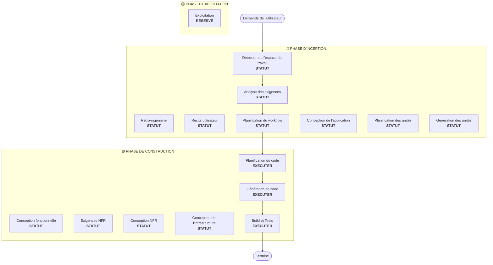

# Planification du workflow

**Objectif** : Déterminer quelles phases exécuter et créer un plan d'exécution complet

**Toujours exécuter** : Cette phase s'exécute toujours après la compréhension des exigences et de la portée

## Étape 1 : Charger tout le contexte antérieur

### 1.1 Charger les artefacts de rétro-ingénierie (si brownfield)
- architecture.md
- component-inventory.md
- technology-stack.md
- dependencies.md

### 1.2 Charger l'analyse des exigences
- requirements.md (inclut l'analyse de l'intention)
- requirement-verification-questions.md (avec réponses)

### 1.3 Charger les récits utilisateur (si exécutés)
- stories.md
- personas.md

## Étape 2 : Analyse détaillée de la portée et de l'impact

**Maintenant que nous disposons du contexte complet (exigences + récits), effectuer une analyse détaillée :**

### 2.1 Détection de la portée de la transformation (brownfield uniquement)

**SI projet brownfield**, analyser la portée de la transformation :

#### Transformation architecturale
- **Changement d'un seul composant** vs **transformation architecturale**
- **Changements d'infrastructure** vs **changements applicatifs**
- **Changements de modèle de déploiement** (Lambda→Conteneur, EC2→Serverless, etc.)

#### Identification des composants liés
Pour les transformations, identifier :
- Le **code d'infrastructure** nécessitant des mises à jour
- Les **stacks CDK** nécessitant des changements
- Les configurations **API Gateway**
- Les exigences de **load balancer**
- Les changements **réseau** nécessaires
- Les adaptations de **supervision/journalisation**

#### Impact inter-packages
- Les packages d'**infrastructure CDK** nécessitant des mises à jour
- Les **modèles partagés** nécessitant des mises à jour de version
- Les **bibliothèques clientes** nécessitant des changements d'endpoints
- Les **packages de test** nécessitant de nouveaux scénarios de test

### 2.2 Évaluation de l'impact du changement

#### Domaines d'impact
1. **Changements destinés aux utilisateurs** : Cela affecte-t-il l'expérience utilisateur ?
2. **Changements structurels** : Cela change-t-il l'architecture du système ?
3. **Changements de modèle de données** : Cela affecte-t-il les schémas de base de données ou les structures de données ?
4. **Changements d'API** : Cela affecte-t-il les interfaces ou les contrats ?
5. **Impact NFR** : Cela affecte-t-il la performance, la sécurité ou la scalabilité ?

#### Impact sur la couche applicative (le cas échéant)
- **Changements de code** : Nouveaux points d'entrée, adaptateurs, configurations
- **Dépendances** : Nouvelles bibliothèques, changements de framework
- **Configuration** : Variables d'environnement, fichiers de configuration
- **Tests** : Tests unitaires, tests d'intégration

#### Impact sur la couche infrastructure (le cas échéant)
- **Modèle de déploiement** : Lambda→ECS, EC2→Fargate, etc.
- **Réseau** : VPC, groupes de sécurité, load balancers
- **Stockage** : Volumes persistants, stockage partagé
- **Scalabilité** : Politiques d'auto-scaling, planification de capacité

#### Impact sur la couche exploitation (le cas échéant)
- **Supervision** : CloudWatch, métriques personnalisées, tableaux de bord
- **Journalisation** : Agrégation de logs, journalisation structurée
- **Alertes** : Configurations d'alarmes, canaux de notification
- **Déploiement** : Changements de pipeline CI/CD, stratégies de rollback

### 2.3 Cartographie des relations entre composants (brownfield uniquement)

**SI projet brownfield**, créer un graphe de dépendances des composants :

```markdown
## Relations entre composants
- **Composant principal** : [Package en cours de modification]
- **Composants d'infrastructure** : [Packages CDK/Terraform]
- **Composants partagés** : [Modèles, utilitaires, clients]
- **Composants dépendants** : [Services qui appellent ce composant]
- **Composants de support** : [Supervision, journalisation, déploiement]
```

Pour chaque composant lié :
- **Type de changement** : Majeur, Mineur, Configuration uniquement
- **Raison du changement** : Dépendance directe, modèle de déploiement, réseau
- **Priorité du changement** : Critique, Important, Optionnel

### 2.4 Évaluation des risques

Évaluer le niveau de risque :
1. **Faible** : Changement isolé, rollback facile, bien compris
2. **Moyen** : Plusieurs composants, rollback modéré, quelques inconnues
3. **Élevé** : Impact à l'échelle du système, rollback complexe, inconnues importantes
4. **Critique** : Critique pour la production, rollback difficile, forte incertitude

## Étape 3 : Détermination des phases

### 3.1 Récits utilisateur - Déjà exécutés ou à ignorer ?
**Déjà exécutés** : Passer à la détermination suivante
**Non exécutés — Exécuter SI** :
- Plusieurs personas utilisateur
- Impact sur l'expérience utilisateur
- Critères d'acceptation nécessaires
- Collaboration d'équipe requise

**Ignorer SI** :
- Refactorisation interne
- Correction de bug avec reproduction claire
- Réduction de dette technique
- Changements d'infrastructure

### 3.2 Conception de l'application - Exécuter SI :
- De nouveaux composants ou services sont nécessaires
- Les méthodes des composants et les règles métier doivent être définies
- Une conception de la couche de service est requise
- Les dépendances entre composants doivent être clarifiées

**Ignorer SI** :
- Changements dans les limites des composants existants
- Aucun nouveau composant ou méthode
- Changements d'implémentation pure

### 3.3 Conception (planification/génération des unités) - Exécuter SI :
- Nouveaux modèles de données ou schémas
- Changements d'API ou nouveaux endpoints
- Algorithmes complexes ou logique métier
- Changements de gestion d'état
- Plusieurs packages nécessitent des changements
- Des mises à jour d'infrastructure-as-code sont nécessaires

**Ignorer SI** :
- Changements de logique simples
- Changements d'interface utilisateur uniquement
- Mises à jour de configuration
- Implémentations directes

### 3.4 Implémentation NFR - Exécuter SI :
- Exigences de performance
- Considérations de sécurité
- Préoccupations de scalabilité
- Supervision/observabilité nécessaire

**Ignorer SI** :
- La configuration NFR existante est suffisante
- Aucune nouvelle exigence NFR
- Changements simples sans impact NFR

## Étape 4 : Noter le niveau de détail adaptatif

**Voir [depth-levels.md](../common/depth-levels.md) pour l'explication de la profondeur adaptative**

Pour chaque étape qui sera exécutée :
- Tous les artefacts définis seront créés
- Le niveau de détail au sein des artefacts s'adapte à la complexité du problème
- Le modèle détermine le niveau de détail approprié selon les caractéristiques du problème

## Étape 5 : Analyse de coordination multi-modules (brownfield uniquement)

**SI projet brownfield avec plusieurs modules/packages**, analyser les dépendances et déterminer la stratégie de mise à jour optimale :

### 5.1 Analyser les dépendances entre modules
- Examiner les dépendances du système de build et les manifestes de dépendances
- Identifier les dépendances au moment du build par rapport à celles au moment de l'exécution
- Cartographier les contrats d'API et les interfaces partagées entre modules

### 5.2 Déterminer la stratégie de mise à jour
Sur la base de l'analyse des dépendances, décider :
- **Séquence de mise à jour** : Quels modules doivent être mis à jour en premier en raison des dépendances
- **Opportunités de parallélisation** : Quels modules peuvent être mis à jour simultanément
- **Exigences de coordination** : Compatibilité des versions, contrats d'API, ordre de déploiement
- **Stratégie de test** : Approche de test par module ou intégrée
- **Stratégie de rollback** : Plan de récupération en cas d'échec en cours de séquence

### 5.3 Documenter le plan de coordination
```markdown
## Stratégie de mise à jour des modules
- **Approche de mise à jour** : [Séquentielle/Parallèle/Hybride]
- **Chemin critique** : [Modules qui bloquent les autres mises à jour]
- **Points de coordination** : [API partagées, infrastructure, contrats de données]
- **Points de contrôle des tests** : [Quand valider l'intégration]
```

Identifier pour chaque module affecté :
- **Priorité de mise à jour** : À mettre à jour en premier vs peut être mis à jour plus tard
- **Contraintes de dépendance** : Ce dont il dépend, ce qui en dépend
- **Portée du changement** : Majeur (rupture), Mineur (compatible), Correctif (corrections)

## Étape 6 : Générer la visualisation du workflow

Créer un flowchart Mermaid montrant :
- Toutes les phases dans l'ordre
- La décision EXÉCUTER ou IGNORER pour chaque phase conditionnelle
- Un style approprié pour l'état de chaque phase

**Règles de style** (à ajouter après le flowchart) :
```
style WD fill:#90EE90,stroke:#2d5016,stroke-width:3px
style CP fill:#90EE90,stroke:#2d5016,stroke-width:3px
style CG fill:#90EE90,stroke:#2d5016,stroke-width:3px
style BT fill:#90EE90,stroke:#2d5016,stroke-width:3px
style US fill:#f0f0f0,stroke:#999999,stroke-width:2px,stroke-dasharray: 5 5
style Start fill:#E6E6FA,stroke:#4B0082,stroke-width:2px
style End fill:#E6E6FA,stroke:#4B0082,stroke-width:2px
```

**Lignes directrices de style** :
- Terminé/Toujours exécuter : `fill:#90EE90,stroke:#2d5016,stroke-width:3px`
- EXÉCUTER conditionnel : `fill:#FFE4B5,stroke:#8B7355,stroke-width:2px,stroke-dasharray: 5 5`
- IGNORER conditionnel : `fill:#f0f0f0,stroke:#999999,stroke-width:2px,stroke-dasharray: 5 5`
- Début/Fin : `fill:#E6E6FA,stroke:#4B0082,stroke-width:2px`

## Étape 7 : Créer le document de plan d'exécution

Créer `aidlc-docs/inception/plans/execution-plan.md` :

```markdown
# Plan d'exécution

## Résumé de l'analyse détaillée

### Portée de la transformation (brownfield uniquement)
- **Type de transformation** : [Composant unique/Architecturale/Infrastructure]
- **Changements principaux** : [Description]
- **Composants liés** : [Liste]

### Évaluation de l'impact du changement
- **Changements destinés aux utilisateurs** : [Oui/Non - Description]
- **Changements structurels** : [Oui/Non - Description]
- **Changements de modèle de données** : [Oui/Non - Description]
- **Changements d'API** : [Oui/Non - Description]
- **Impact NFR** : [Oui/Non - Description]

### Relations entre composants (brownfield uniquement)
[Graphe de dépendances des composants]

### Évaluation des risques
- **Niveau de risque** : [Faible/Moyen/Élevé/Critique]
- **Complexité du rollback** : [Facile/Modérée/Difficile]
- **Complexité des tests** : [Simple/Modérée/Complexe]

## Visualisation du workflow



**Remarque** : Remplacer les indicateurs STATUT par le statut réel de la phase (TERMINÉ/IGNORER/EXÉCUTER) et appliquer le style approprié

## Phases à exécuter

### 🔵 PHASE D'INCEPTION
- [x] Détection de l'espace de travail (TERMINÉ)
- [x] Rétro-ingénierie (TERMINÉ/IGNORÉ)
- [x] Élaboration des exigences (TERMINÉ)
- [x] Récits utilisateur (TERMINÉ/IGNORÉ)
- [x] Plan d'exécution (EN COURS)
- [ ] Conception de l'application - [EXÉCUTER/IGNORER]
  - **Justification** : [Pourquoi exécuter ou ignorer]
- [ ] Planification des unités - [EXÉCUTER/IGNORER]
  - **Justification** : [Pourquoi exécuter ou ignorer]
- [ ] Génération des unités - [EXÉCUTER/IGNORER]
  - **Justification** : [Pourquoi exécuter ou ignorer]

### 🟢 PHASE DE CONSTRUCTION
- [ ] Conception fonctionnelle - [EXÉCUTER/IGNORER]
  - **Justification** : [Pourquoi exécuter ou ignorer]
- [ ] Exigences NFR - [EXÉCUTER/IGNORER]
  - **Justification** : [Pourquoi exécuter ou ignorer]
- [ ] Conception NFR - [EXÉCUTER/IGNORER]
  - **Justification** : [Pourquoi exécuter ou ignorer]
- [ ] Conception de l'infrastructure - [EXÉCUTER/IGNORER]
  - **Justification** : [Pourquoi exécuter ou ignorer]
- [ ] Planification du code - EXÉCUTER (TOUJOURS)
  - **Justification** : Une approche d'implémentation est nécessaire
- [ ] Génération de code - EXÉCUTER (TOUJOURS)
  - **Justification** : L'implémentation du code est nécessaire
- [ ] Build et Tests - EXÉCUTER (TOUJOURS)
  - **Justification** : Le build, les tests et la vérification sont nécessaires

### 🟡 PHASE D'EXPLOITATION
- [ ] Exploitation - RÉSERVÉ
  - **Justification** : Futurs workflows de déploiement et de supervision

## Séquence de changement des packages (brownfield uniquement)
[Le cas échéant, lister la séquence de mise à jour des packages avec leurs dépendances]

## Calendrier estimé
- **Total des phases** : [Nombre]
- **Durée estimée** : [Estimation de temps]

## Critères de succès
- **Objectif principal** : [Objectif principal]
- **Livrables clés** : [Liste]
- **Points de contrôle qualité** : [Liste]

[SI brownfield]
- **Tests d'intégration** : Tous les composants fonctionnent ensemble
- **Préparation opérationnelle** : Supervision, journalisation, alertes fonctionnelles
```

## Étape 8 : Initialiser le suivi d'état

Mettre à jour `aidlc-docs/aidlc-state.md` :

```markdown
# Suivi de l'état AI-DLC

## Informations sur le projet
- **Type de projet** : [Greenfield/Brownfield]
- **Date de début** : [horodatage ISO]
- **Étape actuelle** : INCEPTION - Planification du workflow

## Résumé du plan d'exécution
- **Total des étapes** : [Nombre]
- **Étapes à exécuter** : [Liste]
- **Étapes à ignorer** : [Liste avec raisons]

## Progression des étapes

### 🔵 PHASE D'INCEPTION
- [x] Détection de l'espace de travail
- [x] Rétro-ingénierie (le cas échéant)
- [x] Analyse des exigences
- [x] Récits utilisateur (le cas échéant)
- [x] Planification du workflow
- [ ] Conception de l'application - [EXÉCUTER/IGNORER]
- [ ] Planification des unités - [EXÉCUTER/IGNORER]
- [ ] Génération des unités - [EXÉCUTER/IGNORER]

### 🟢 PHASE DE CONSTRUCTION
- [ ] Conception fonctionnelle - [EXÉCUTER/IGNORER]
- [ ] Exigences NFR - [EXÉCUTER/IGNORER]
- [ ] Conception NFR - [EXÉCUTER/IGNORER]
- [ ] Conception de l'infrastructure - [EXÉCUTER/IGNORER]
- [ ] Planification du code - EXÉCUTER
- [ ] Génération de code - EXÉCUTER
- [ ] Build et Tests - EXÉCUTER

### 🟡 PHASE D'EXPLOITATION
- [ ] Exploitation - RÉSERVÉ

## Statut actuel
- **Phase du cycle de vie** : INCEPTION
- **Étape actuelle** : Planification du workflow terminée
- **Étape suivante** : [Prochaine étape à exécuter]
- **Statut** : Prêt à continuer
```

## Étape 9 : Présenter le plan à l'utilisateur

```markdown
# 📋 Planification du workflow terminée

J'ai créé un plan d'exécution complet basé sur :
- Votre demande : [Résumé]
- Système existant : [Résumé si brownfield]
- Exigences : [Résumé si exécutées]
- Récits utilisateur : [Résumé si exécutés]

**Analyse détaillée** :
- Niveau de risque : [Niveau]
- Impact : [Résumé des impacts clés]
- Composants affectés : [Liste]

**Plan d'exécution recommandé** :

Je recommande d'exécuter [X] étapes :

🔵 **PHASE D'INCEPTION :**
1. [Nom de l'étape] - *Justification :* [Pourquoi l'exécuter]
2. [Nom de l'étape] - *Justification :* [Pourquoi l'exécuter]
...

🟢 **PHASE DE CONSTRUCTION :**
3. [Nom de l'étape] - *Justification :* [Pourquoi l'exécuter]
4. [Nom de l'étape] - *Justification :* [Pourquoi l'exécuter]
...

Je recommande d'ignorer [Y] étapes :

🔵 **PHASE D'INCEPTION :**
1. [Nom de l'étape] - *Justification :* [Pourquoi l'ignorer]
2. [Nom de l'étape] - *Justification :* [Pourquoi l'ignorer]
...

🟢 **PHASE DE CONSTRUCTION :**
3. [Nom de l'étape] - *Justification :* [Pourquoi l'ignorer]
4. [Nom de l'étape] - *Justification :* [Pourquoi l'ignorer]
...

[SI brownfield avec plusieurs packages]
**Séquence de mise à jour des packages recommandée** :
1. [Package] - [Raison]
2. [Package] - [Raison]
...

**Calendrier estimé** : [Durée]

> **📋 <u>**EXAMEN REQUIS :**</u>**  
> Veuillez examiner le plan d'exécution à : `aidlc-docs/inception/plans/execution-plan.md`

> **🚀 <u>**ET ENSUITE ?**</u>**
>
> **Vous pouvez :**
>
> 🔧 **Demander des modifications** — Demander des modifications au plan d'exécution si nécessaire
> [SI des étapes sont ignorées :]
> 📝 **Ajouter les étapes ignorées** — Choisir d'inclure les étapes actuellement marquées IGNORER
> ✅ **Approuver et continuer** — Approuver le plan et passer à **[Nom de l'étape suivante]**
```

## Étape 10 : Gérer la réponse de l'utilisateur

- **Si approuvé** : Passer à l'étape suivante du plan d'exécution
- **Si des modifications sont demandées** : Mettre à jour le plan d'exécution et reconfirmer
- **Si l'utilisateur souhaite forcer l'inclusion/l'exclusion d'étapes** : Mettre à jour le plan en conséquence

## Étape 11 : Consigner l'interaction

Consigner dans `aidlc-docs/audit.md` :

```markdown
## Planification du workflow - Approbation
**Horodatage** : [horodatage ISO]
**Prompt de l'IA** : « Prêt à continuer avec ce plan ? »
**Réponse de l'utilisateur** : « [réponse BRUTE COMPLÈTE de l'utilisateur] »
**Statut** : [Approuvé/Modifications demandées]
**Contexte** : Plan de workflow créé avec [X] étapes à exécuter

---
```
